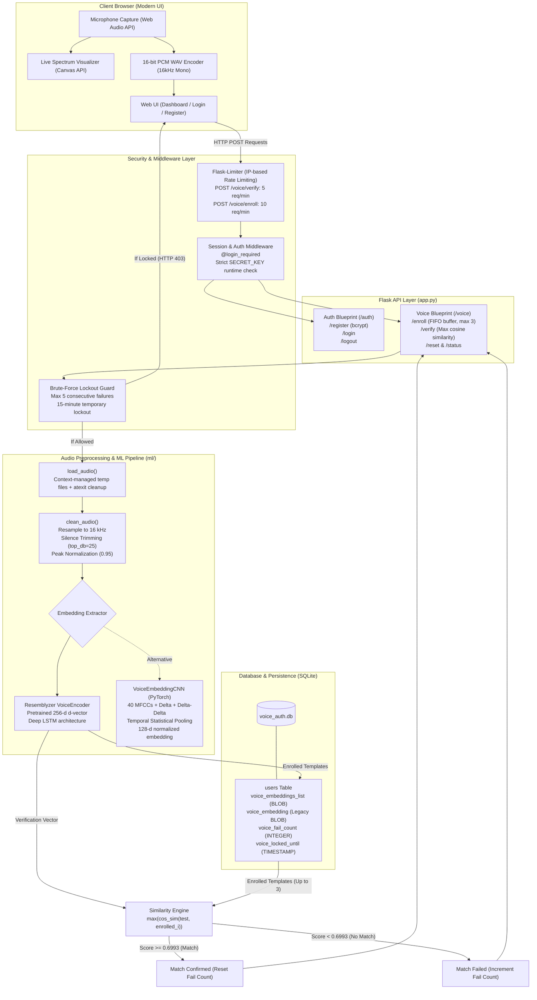

# 🎙️ Voice-Based Authentication System

A production-ready biometric voice authentication platform built with **Flask**, **Resemblyzer (Deep Voice d-vectors)**, **PyTorch CNNs**, **Librosa**, and **SQLite**. 

The system enables secure, passwordless authentication using acoustic speaker characteristics, featuring multi-sample enrollment (up to 3 templates per user), maximum cosine similarity matching, rate limiting, and automated brute-force account lockout protection.

---

## 📐 System Architecture

The following diagram illustrates the complete end-to-end architecture from in-browser audio capture to feature extraction, embedding generation, security enforcement, and persistent storage:



---

## 📊 Biometric Performance & EER Benchmark

The speaker verification models were benchmarked on genuine and impostor speech pairs extracted from the **VoxCeleb1** test dataset across **7,140 pairwise comparisons** (20 speakers, 6 utterances each):

### Benchmark Comparison Table

| Metric | Resemblyzer (d-vector) | Custom VoiceEmbeddingCNN | Advantage / Notes |
| :--- | :---: | :---: | :--- |
| **Equal Error Rate (EER)** | **`3.00%`** | `10.33%` | **Resemblyzer** achieves **71% lower error rate** |
| **Area Under ROC (AUC-ROC)** | **`0.9961`** | `0.9519` | Near-perfect discrimination ($\approx 1.0$) |
| **Optimal EER Threshold** | **`0.6993`** ($\approx 0.70$) | `0.9451` | Default production verification threshold |
| **Mean Genuine Score** | `0.8671` | `0.9673` | Average similarity for same-speaker pairs |
| **Mean Impostor Score** | `0.5807` | `0.8885` | Average similarity for different-speaker pairs |
| **Separation Margin** | **`+0.2864`** | `+0.0788` | **$3.6\times$ wider safety margin** between genuine and impostors |
| **Embedding Dimension** | `256` | `128` | Compact vector representation |
| **Inference Latency** | `27.1 ms` | **`16.1 ms`** | Real-time performance on CPU |
| **Duration Invariance** | Pretrained LSTM | Temporal Statistical Pooling | Both models handle variable-length speech |

> [!TIP]
> The production threshold is configured to `0.6993` in `voice.py`, which precisely matches the Equal Error Rate operating point where False Acceptance Rate (FAR) equals False Rejection Rate (FRR).

---

## ⚠️ Known Limitations

While the system demonstrates strong verification metrics (3.00% EER), practical biometric deployments encounter edge cases:

- **No Liveness Detection / Anti-Spoofing:** The current verification engine validates speaker acoustic identity but does not mitigate replay attacks (e.g. pre-recorded audio playback through a loudspeaker) or high-fidelity synthetic voice generation / deepfakes. Production hardening would incorporate challenge-response dynamic passphrases or spectral liveness classifiers.
- **Single-Device Enrollment & Domain Shift:** Acoustic embeddings are sensitive to microphone frequency response curves. Voice profiles enrolled on a laptop built-in microphone may exhibit reduced similarity scores when verifying from a mobile phone or studio headset.
- **Acoustic Noise Sensitivity:** While energy-based silence trimming and amplitude normalization mitigate moderate noise, high ambient background noise (low Signal-to-Noise Ratio) can distort mel-filterbank representations and increase the False Rejection Rate (FRR).

---

## 🛡️ Security Features

- **Multi-Sample Enrollment (FIFO Buffer):**
  - Users can enroll up to **3 distinct voice samples** to capture intra-speaker acoustic variation (pitch, morning vs. evening voice, microphone distance).
  - When a 4th sample is recorded, the system automatically replaces the oldest sample in a FIFO ring buffer.
  - Verification evaluates the test utterance against all enrolled templates and selects the **maximum cosine similarity score**.
- **Brute-Force Account Lockout:**
  - Tracks consecutive failed voice verification attempts (`voice_fail_count`).
  - After **5 consecutive failed attempts**, voice login for that account is locked for **15 minutes** (`voice_locked_until`).
  - Requests during the lockout period are rejected before audio processing with HTTP `403` and the exact minutes remaining.
  - A successful verification immediately resets the failure counter to `0`.
- **IP-Based Rate Limiting:**
  - `POST /voice/verify`: Capped at **5 requests per minute** per IP address.
  - `POST /voice/enroll`: Capped at **10 requests per minute** per IP address.
  - Exceeding the rate limit returns a standard HTTP `429` JSON response:
    ```json
    {"success": false, "error": "Too many attempts. Try again later."}
    ```
- **Robust Temporary File Management:**
  - Audio uploads requiring disk fallbacks use context-managed `tempfile.NamedTemporaryFile(delete=False)`.
  - Enclosed in strict `try/finally` blocks ensuring immediate deletion after reading.
  - Registered `@atexit` process handlers automatically clear any dangling files on unexpected shutdown.
- **Strict Environment Configuration:**
  - Production requires explicit `SECRET_KEY` definition. The application refuses to start with hardcoded fallback secrets.

---

## 🚀 Getting Started

### 1. Prerequisites

- **Python 3.10+** (Tested on Python 3.10, 3.11, and 3.12)
- **C/C++ Build Tools / Pre-built Wheels** (for audio processing libraries)
- A working microphone (with Web Audio API permissions enabled in your browser)

### 2. Clone the Repository

```bash
git clone https://github.com/brajcoder/Voice-Based-Authentication-System.git
cd Voice-Based-Authentication-System
```

### 3. Create & Activate Virtual Environment

**Windows (PowerShell):**
```powershell
python -m venv venv
.\venv\Scripts\Activate.ps1
```

**Linux / macOS:**
```bash
python3 -m venv venv
source venv/bin/activate
```

### 4. Install Dependencies

```bash
pip install --upgrade pip
pip install -r requirements.txt
```

> [!NOTE]
> On Windows, `webrtcvad-wheels` is included in `requirements.txt` to avoid requiring Microsoft C++ Build Tools during compilation.

### 5. Set Environment Variables & Launch

The system strictly requires the `SECRET_KEY` environment variable for cryptographic session security:

**Windows (PowerShell):**
```powershell
$env:SECRET_KEY = "super-secret-random-key-change-in-production"
python app.py
```

**Windows (Command Prompt):**
```cmd
set SECRET_KEY=super-secret-random-key-change-in-production
python app.py
```

**Linux / macOS (Bash):**
```bash
export SECRET_KEY="super-secret-random-key-change-in-production"
python app.py
```

Open your browser and navigate to:
```
http://127.0.0.1:5000
```

---

## 📖 Usage Guide

### 1. User Registration
1. Navigate to `http://127.0.0.1:5000/register`.
2. Enter a unique username and password.
3. Upon registration, you will be redirected to the login page.

### 2. Multi-Sample Voice Enrollment
1. Log in with your username and password to access the **Dashboard**.
2. Under **Voice Profile Enrollment**, click the microphone button.
3. Speak your passphrase clearly into the microphone.
4. Click **Stop**, review the waveform preview, and click **Save Voice Sample**.
5. Repeat up to 3 times to store multiple acoustic representations for optimal verification accuracy.

### 3. Biometric Verification & Voice Login
- **Dashboard Verification Test:** Authenticated users can test their voice in real-time from the dashboard and inspect the cosine similarity score, match percentage, and decision threshold.
- **Passwordless Voice Login:** From the login screen, switch to the **Login with Voice** tab, enter your username, record your voice, and authenticate without entering a password.

---

## 🧪 Running Evaluations & Training

### Evaluate Models on VoxCeleb1

To reproduce the EER benchmark and compare Resemblyzer against the PyTorch CNN:

```bash
# Evaluate Resemblyzer d-vector
python -m ml.evaluate

# Evaluate PyTorch VoiceEmbeddingCNN
python -m ml.evaluate --model cnn
```

### Train Custom VoiceEmbeddingCNN

To retrain the PyTorch CNN on speaker identification using CrossEntropyLoss and the Adam optimizer:

```bash
python -m ml.train
```

---

## 📁 Repository Structure

```
Voice-Based-Authentication-System/
├── app.py                  # Flask application factory, error handlers & routing
├── database.py             # SQLite schema, migrations, CRUD & lockout management
├── auth.py                 # Password authentication, session control, login_required
├── voice.py                # Biometric enrollment, verification & rate limiting
├── extensions.py           # Shared extensions (Flask-Limiter)
├── voice_auth.db           # SQLite database (auto-generated on first run; ignored by git)
├── requirements.txt        # Pinned Python package dependencies
├── ml/
│   ├── preprocess.py       # Resampling, silence trimming, normalization & safe temp files
│   ├── features.py         # 40-MFCCs, velocity (delta), acceleration (delta-delta)
│   ├── model.py            # Resemblyzer VoiceEncoder + PyTorch VoiceEmbeddingCNN
│   ├── dataset.py          # VoxCeleb dataset loader with noise augmentation
│   ├── train.py            # Speaker classifier training with CrossEntropyLoss & Adam
│   └── evaluate.py         # EER, AUC-ROC & threshold benchmarking script
├── static/
│   ├── recorder.js         # Browser audio recorder, PCM WAV encoder & visualizer
│   └── style.css           # Modern dark-mode UI stylesheet
└── templates/
    ├── index.html          # Dual-mode login page (Password & Voice login)
    ├── register.html       # User registration page
    └── dashboard.html      # Biometric enrollment & live verification dashboard
```

---

## 📄 License

This project is open-source and available under the [MIT License](LICENSE).
